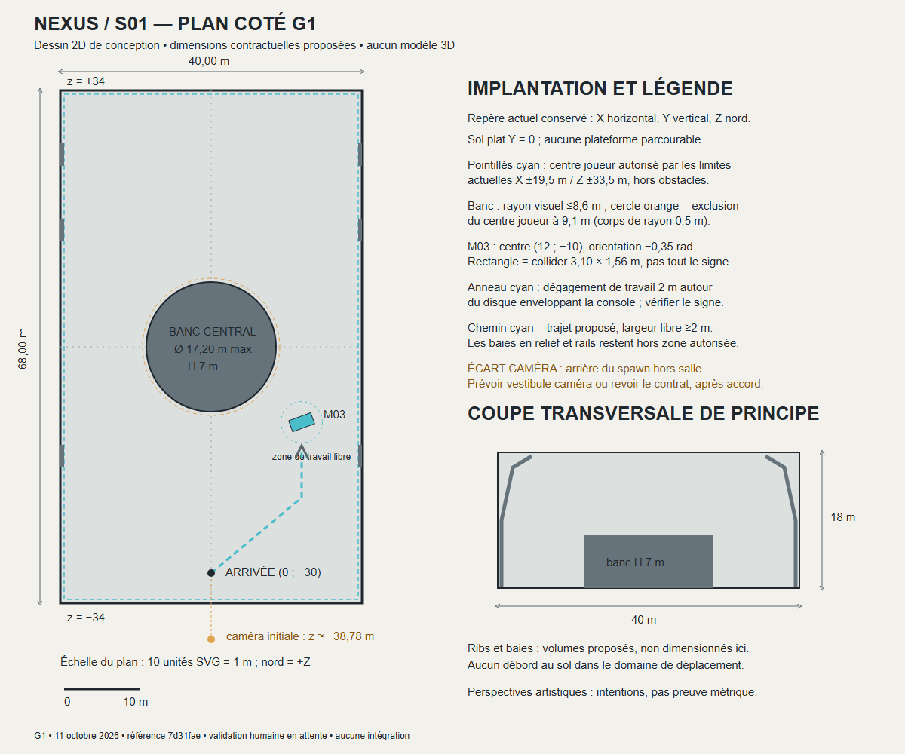
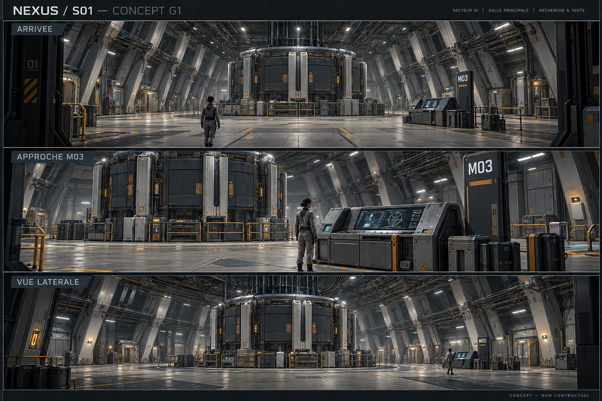
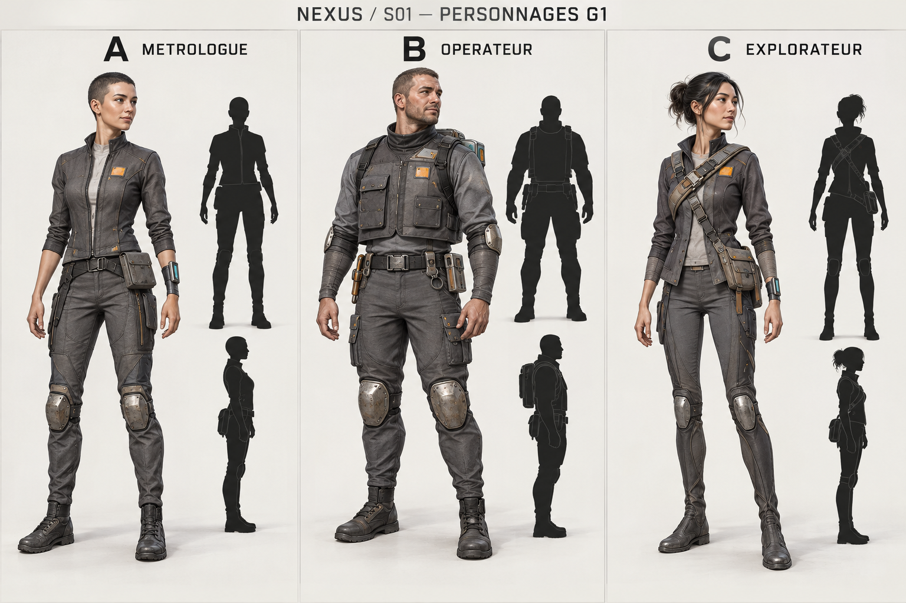
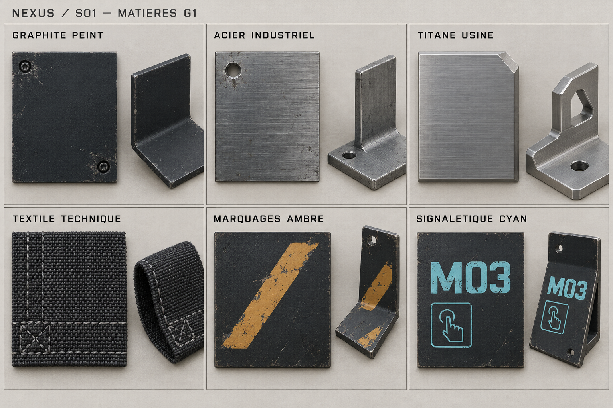

# M03.3 / G1 — Concepts pour revue humaine

11 octobre 2026. Branche `review/m03-tokenisation`, référence documentaire et HEAD : `7d31faee9205471a5fbe435ffb77a1d3aff2bed2`. **Concepts produits, choix et validation humaine en attente.** Aucune modélisation, intégration, refonte pédagogique ou publication effectuée.

## 1. Planches consultables et méthode

Les trois planches artistiques sont de nouvelles images générées avec l'outil intégré `image_gen`, selon le skill [imagegen](C:/Users/tsaut/.codex/skills/.system/imagegen/SKILL.md). Ce ne sont ni des captures du jeu ni des rendus de modèles construits. Le plan est dessiné directement en SVG et rendu en PNG par Chromium. Les [prompts complets](g1/generation-prompts.json) sont conservés pour permettre une critique ou une itération ciblée. Aucun asset définitif n'a été produit.

| Livrable | Consultation | Statut |
|---|---|---|
| Plan coté, implantation et coupe | [PNG](g1/sector01-dimensioned-plan.png) · [SVG vectoriel](g1/sector01-dimensioned-plan.svg) | Référence géométrique de conception ; salle 40 × 68 × 18 m |
| Salle : arrivée, approche M03, vue latérale | [Triptyque salle](g1/sector01-room-concepts.png) | Trois vues d'intention du même langage architectural, pas une reconstruction métrique |
| Personnage : A, B, C | [Trois variantes et silhouettes face/profil](g1/technician-three-variants.png) | Comparaison de proportions et équipements ; aucune variante sélectionnée |
| Six matériaux | [Planche matières](g1/material-study.png) | Études visuelles, pas des textures seamless ou cartes PBR utilisables |
| Contrôle de circulation et caméra | [Résultats géométriques](g1/geometry-checks.json) | Calcul sur contrats actuels, pas validation du futur décor |

## 2. Salle — signature et logique constructive

Signature proposée : **nervures jumelées, consoles de fixation obliques et panneaux de maintenance en retrait**. Les nervures portent l'enveloppe ; les consoles supportent des chemins de câbles ; les carters se remplacent par modules. Le noyau devient un banc de calcul/refroidissement opaque, rythmé de pièces usinées claires. Il ne représente pas un cerveau et n'explique pas visuellement le mécanisme d'un LLM.

Hiérarchie : banc central comme équipement majeur, plaque M03 comme repère d'action, ossature répétée comme fond. L'entrée regarde vers +Z ; M03 reste au sud-est du banc, à droite de l'arrivée. Les accents ambre sont peints et fonctionnels ; cyan réservé à la disponibilité de l'interaction. Les luminaires blancs éclairent les postes, sans néons périphériques.

| Vue | Ce qu'elle permet de juger | Ce qu'elle ne garantit pas |
|---|---|---|
| Arrivée | Identification du banc, plaque M03 à droite, circulation contournant le noyau, répétition constructive | Dimension exacte, angle de caméra existante ou repérage en moins de 5 s par un élève |
| Approche M03 | Écran encastré incliné, plaque non lumineuse et console physiquement distincte | Taille exacte du signe, accessibilité d'un équipement physique ou fonctionnement des commandes dessinées |
| Latérale | Rapport des équipements à la salle, espaces libres, continuité des nervures et réseaux | Géométrie cohérente à tous les angles ; cette image n'est pas un modèle partagé avec les deux autres |

**Écarts visuels constatés à l'inspection des images :** les gardes-corps entourant le banc et certains caissons latéraux pourraient dépasser les collisions prévues ; les panneaux présentent beaucoup de petites fixations ; le sol est plus réfléchissant que souhaité ; la console possède plusieurs graphismes de commande. Pour une suite validée : contenir gardes-corps/supports dans le rayon 8,6 m, simplifier les fixations en normal maps, augmenter la roughness du sol, rendre l'écran plus sobre et supprimer toute commande suggérant une action inexistante. La console doit toujours ouvrir le panneau DOM accessible existant. Le triptyque est une direction, pas un blanc-seing pour chaque détail.

## 3. Personnage — trois propositions distinctes

Les variantes partagent la hauteur cible de 1,75 m, le graphite textile, les pièces métalliques ponctuelles et les mains libres. Leur sexe/apparence ne constituent pas leur différence fonctionnelle : celle-ci vient des masses, lignes et équipements. Pas de référence à une franchise dans les prompts ; une revue humaine de ressemblance reste nécessaire, sans prétendre certifier l'originalité juridique d'une image générée.

| Critère | A — Métrologue | B — Opérateur | C — Explorateur |
|---|---|---|---|
| Proportions / contour | Vertical, veste courte ajustée, épaules étroites, jambes droites | Masse supérieure large, gilet court carré, jambes plus effilées | Torse étroit, ligne diagonale du harnais, petite asymétrie de hanche |
| Fonction | Mesurer et inspecter les équipements | Diagnostiquer et intervenir sur les baies | Relever et transporter des échantillons de terrain |
| Équipement | Sonde au poignet, petite pochette plate latérale | Instruments fixes à la ceinture, module dorsal compact | Harnais textile, sacoche d'échantillons basse, afficheur de poignet |
| Justification matière | Textile souple pour gestes fins ; métal limité aux protections et outil | Gilet résistant à l'abrasion ; fixations acier, inserts usinés | Textile léger ; renforts locaux, attaches métal sans armure |
| Lecture en silhouette | Forme simple et claire ; pochette parfois discrète | Meilleur contraste de masse et épaules ; sac dorsal visible en profil | Asymétrie lisible en couleur ; A et C restent proches en noir de face |
| Risque distance | Petit outil et plaque peuvent disparaître à 9 m | Masse supérieure identifiable ; détails de ceinture à simplifier | Harnais diagonal peu lisible en silhouette pure ; conserver la sacoche comme repère |
| Rigging / mouvement | Faible : veste courte, outils rigidement attachés | Moyen : sac dorsal, coudes et instruments proches du bassin | Moyen : harnais/sacoche, cheveux attachés ; pans courts à contraindre |
| Corrections avant production | Protections genoux moins volumineuses, marquage NEXUS original | Alléger sac et renforts pour éviter allure militaire ; pas de sangle flottante | Réduire tout pan descendant sur la cuisse, contenir cheveux et sacoche |
| Allocation LOD0 proposée | 16k triangles | 20k triangles maximum | 18k triangles |
| Matériaux / textures | ≤3 primitives, un set 1024² partagé corps/accessoires | Identique ; aucune texture supplémentaire pour le sac | Identique ; cheveux opaques simplifiés, pas de couches alpha |

Les petites silhouettes face/profil sont réellement présentes sur la planche. **Lisibilité à 9 m dans le jeu non testée** : le jugement ci-dessus est une inspection comparative du concept. Après choix, demander une planche face/profil/dos à échelle commune et une présentation en miniature/gris correspondant à la taille projetée de la caméra. Aucun turnaround complet d'une variante choisie ne peut être finalisé avant ce choix.

Rig cible commun : ≤70 joints, ≤4 influences/sommet, clips `idle` et locomotion in-place. Outils sans articulation propre si inutiles, accessoires dans le gabarit circulaire de rayon 0,5 m, absence de collision par os. Tester bras/cuisses, boucle et pied au sol lors d'une future production. La vitesse actuelle de 7 m/s demande une locomotion rapide adaptée ou une modification de vitesse distinctement autorisée ; aucun choix de clip ne doit recréer de marche sur place.

Préférence proposée, **non sélection imposée** : A comme base la plus sobre et économique ; B si l'identification à distance prime ; C si l'exploration devient la dimension narrative retenue. Éviter un hybride cumulant tous les accessoires.

## 4. Matériaux — étude et transposition prévue

| Étude | Base proposée | Metallic / roughness de départ | Traitement futur |
|---|---|---|---|
| Graphite peint | `#20282E` | 0 / 0,65–0,85 | Peinture poudre, usure localisée aux contacts ; métal exposé par masque |
| Acier industriel | `#66737B` | 1 / 0,45–0,65 | Brossage discret et fixations crédibles |
| Titane usiné | `#A4ABB0` | 1 / 0,35–0,55 | Fines traces d'usinage, chanfreins limités à la silhouette |
| Textile technique | Graphite neutre | 0 / 0,75–0,9 | Tissage en normal map ; coutures utiles, pas de microgéométrie |
| Marquages ambre | `#DFA24D` | 0 / 0,6–0,8 | Peinture ou decal opaque, aucune émission |
| Signalétique cyan | `#4BBCCA` | 0 / 0,55–0,75 | Texte et symbole, aucune émission sur la plaque ; petit indicateur éventuel seulement |

Valeurs proposées, pas extraites physiquement des images. Les swatches montrent une usure parfois excessive : la réduire pour un laboratoire entretenu. La couleur affichée dépend de la génération et de l'écran ; les hex de la bible restent la référence. Les six études ne signifient pas six sets de textures uniques : deux trims environnement et un set personnage sont prévus, maps base/normal/ORM partagées. Le tissage proche ne doit pas produire de moiré en vue de jeu.

## 5. Confrontation technique et écarts

| Contrat actuel / budget | Conception G1 | Écart ou décision avant suite |
|---|---|---|
| Salle 40 × 68 × 18 m, sol plat | Plan et coupe aux dimensions ; spawn `(0,-30)`, M03 `(12,-10)` conservés | Perspectives non métriques ; pas d'escalier jouable |
| Centre joueur X ±19,5 / Z ±33,5 ; corps r=0,5 | Faces intérieures de murs aux limites X ±20 / Z ±34 | Aucune nervure/baie ne peut avancer au sol dans cette marge. Baies épaisses demandent niches hors enveloppe ou revue explicite ; pas de placement arbitraire à X ±18 |
| Banc collision r=8,6 ; exclusion joueur r=9,1 | Banc Ø17,2 m maximum, H7 m | Gardes-corps du concept à contenir dans ce diamètre ; aucune excroissance hors collider |
| Console collider 3,10 ×1,56, angle −0,35 | Enveloppe rendue cible 3 ×1,4 au sol ; plaque dans l'emprise | Position du poteau non garantie par l'image ; plan fait foi |
| Passage ≥2 m | Trajet `(0,-30) → (12,-20) → (12,-14)` et zone de travail sans props | Échantillonnage du corridor de centres joueur : voir JSON ; pas test du décor futur |
| E/AGIR à distance <6 m | Arrêt proposé à 4 m du centre M03 | Conserver contrôle réel, nom et bouton d'accès accessible ; couleurs seules insuffisantes |
| Caméra rayon 6–20, beta 0,8–1,5 | Plafond 18 m ; hauteur théorique max ≈16,63 m au-dessus du sol | Poutres/équipements suspendus peuvent gêner ; mapping occluders futur explicite |
| Caméra derrière le spawn | Rayon initial 9, beta1,35 : z caméra ≈−38,78 | **Hors salle z≥−34**. Aux limites/rayon20, débord peut approcher20 m ; un vestibule de5 m ne règle pas toutes les orientations |
| Rendu ≤180k triangles visibles, ≤16 matériaux, ≤96 MiB textures | Allocation 145k maximum avec B ; A/C abaissent la part personnage | Planche détaillée non preuve de budget ; vis/câbles majoritairement textures, instances et simplification |
| ≤100 draw calls de base ; ≤120 avec passes optionnelles | Banc ≤8 primitives, personnage ≤3, familles matérielles partagées | Ne pas créer un mesh/draw call par panneau ou fixation dessiné ; aucune mesure runtime G1 |
| M03 / brouillons / Pyodide | Aucun fichier applicatif ni clé de stockage modifié | Tests pédagogiques et performance requis lors d'une intégration future, pas ici |

Le corridor de conception a été échantillonné à pas ≤0,1 m sur sa ligne et deux bords à ±1 m, avec `src/collision.js` réel. Zéro point échantillonné bloqué. Ce contrôle discret n'est pas une preuve continue ni un essai navigateur ; il ne comprend aucun nouvel obstacle. Le dessin indique un disque de travail autour de la console, pas un nouvel espace d'interaction programmé.

**Choix caméra à trancher :** conserver une salle centrale de 40 ×68 m et prévoir une enveloppe extérieure/vestibule accueillant la caméra, ou autoriser ultérieurement une contraction d'occlusion intégrée aux murs et testée dans les nouveaux assets. Déplacer le spawn ou réduire silencieusement le rayon est exclu. L'hypothèse de compatibilité complète de la préproduction initiale n'est donc pas confirmée ; G2 devra résoudre ce point avant intégration.

## 6. Preuves de livraison et limites

- Branche et HEAD contrôlés avant création, état initial propre ; les cinq références documentaires relues. Contrats relus dans `index.html` et `src/collision.js`.
- Trois générations intégrées réellement effectuées, PNG sauvegardés dans `docs/art/g1/`, images inspectées visuellement ; prompts conservés. Plan SVG rendu réellement par Chromium en PNG 1200 ×1000, puis inspecté.
- Contrôle géométrique réel et résultats JSON ; inventaire de fichiers et liens locaux contrôlés en fin de mission. Aucun benchmark GPU, rigging, export ou gate applicatif exécuté ici ; aucun PASS pédagogique nouveau revendiqué.
- Les images générées peuvent comporter incohérences spatiales et détails trop coûteux. Elles donnent une intention artistique, pas des données à importer dans Babylon. Aucun nouveau modèle, GLB, texture runtime ou configuration n'est ajouté.
- Pas de nouvelle mesure avec élèves, de test de repérage en5s ou de performance lycée. L'originalité perçue, la lisibilité et la crédibilité industrielle restent à examiner par des humains.

La génération n'utilise aucune image tierce en référence ; conserver sa provenance technique ne constitue pas une certification juridique d'exclusivité. Toute future production d'assets suit le registre de droits du pipeline. Les prompts et images sont des livrables documentaires de conception ; rien n'est placé dans `public/assets/`.

## 7. Décisions humaines attendues — arrêt G1

1. Valider ou corriger les nervures jumelées, les carters et le banc central ; accepter le traitement industriel tout en réduisant rails, reflets et microdétails signalés.
2. Choisir A, B ou C, ou demander une itération ciblée ; ensuite seulement produire le turnaround complet de la variante retenue. Valider sa fonction et éviter toute ressemblance jugée problématique.
3. Valider console opaque + plaque M03 lisible + ouverture du panneau pédagogique existant, sans commandes décoratives trompeuses.
4. Approuver les six familles de matières et leur usure réduite ; garder les accents non lumineux majoritaires.
5. Décider du traitement de l'enveloppe caméra et des baies : le plan40 ×68 m est provisoire et présente un écart documenté, pas un G2 acquis.
6. Choisir la politique vitesse/locomotion avant animation ; retenir les plafonds proposés jusqu'à mesure sur matériel lycée.

**G1 s'arrête ici. Aucun choix n'est validé à la place de l'utilisateur. Attendre validation humaine avant modélisation, création de GLB ou intégration. Aucun commit, push, merge ou déploiement effectué par cette mission.**
